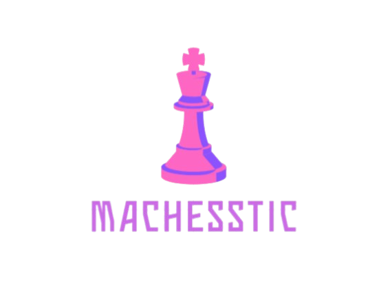

<p align="center">

</p>
<p align="center">
  
  
  
  
  
  
  <br>
  
  
   
</p>


## ♟️ Briefly about the app

Machesstic is full-stack chess web application designed to make chess free-to-play and easily accessible to everyone.

## 🖥️ Functionalities
This application provides many functionalites such as:
* Creating account with email validation

* Safe login system with JWT

* Playing games with other players on similar elo

* Players profiles are public to anyone

* Editing profiles 

* Playing with friends (work in progress)


## 🔨 Technologies and project structue

### ⚙️ Prerequisites
Ensure you have the following installed on your machine:

* Git

* Docker Desktop (for Docker setup)

* Node.js (v18+) & MySQL (for local setup without Docker)

### 📖 Technologies and libraries:
In this part technologies used for server and client are presented and also there is a brief overview of folder structure in th project.

* #### Most esential for server part:
    * Express js
    * Mysql 2
    * jsonwebtoken
    * socket.io
* #### Client part
    * React (Vite)
    * Axios
    * React-router-dom
    * Scss

### 🏗️ Project structure overview

```
Machesstic/
│  
├── client/
│   ├── package.json            # Dependencies for  client
│   └── src/  
│       ├── assets/             # Images and gifs 
│       ├── components/         # Subcomponents for the app     
│       ├── styles/             # Styles  
│       └── main.jsx            # Main component with routing          
│  
├── server/
│   ├── package.json            # Dependencies for  server          
│   ├── chess_game.js           # All of game logic        
│   ├── database_connector.js   # Connection with database      
│   └── main_server.js          # Main server 
│  
├── Dockerfile                  # Dockerfile
├── .env                        # Enviormental variables
├── schema.sql                  # Database schema
└── docker-compose.yml          # Docker compose
```

## 🚀 Setup

In this section you will get specific steps you need to follow to deploy this app:
1. Create .env file in **root directory** with given variables:

    ```
    # Server port
    SERVER_PORT=3000

    # Database connection data

    DATABASE_HOST=db # or localhost if you use docker
    DATABASE_USER=chess_user
    DATABASE_PASSWORD=chess_password
    DATABASE_NAME=chess_db

    # Tokens for jwt
    ACCESS_TOKEN_SECRET=your_access_token_secret
    REFRESH_TOKEN_SECRET=your_refresh_token_secret

    # For sending email you need to configure smtp
    SMTP_HOST=smtp_host
    SMTP_PORT=smtp_port
    SMTP_EMAIL=your_email@gmail.com
    SMTP_PASSWORD=smtp_password

    # After disconnect player have given time in miliseconds to reconnect
    PLAYER_TIMEOUT=10000 
    ```
2. If you are using docker all you need to do is run:
    ```
    docker compose up --build 
    ```
3. If you are not using docker it gets more complicated. You need to follow this steps:
    * Create mysql database in and import **schema.sql**
    * For client you need to use:

        ```
        cd client # Change directory
        npm install # Install all dependencies
        npm run build # Run application
        ```   
        ```
        #If you are running client in development instead of last command type this
        npm run dev
        ```
    * **IMPORTANT** Copy client/dist to server/public
    * Run server with: 
        ```
        cd ../server # Change directory
        npm install # Install all dependencies
        node main_server.js # Run server
        ```
        ```
        #In case you are running server in development instead of last command type this
        npm run devServer
        ```
4. Voilà! In both cases you can access all services in given ports:
    ```
    # Application
    http://localhost:3000

    # For docker phpmyadmin (use login from .env)
    http://localhost:8080

    # Without docker its localhost port so probably
    http://localhost/phpmyadmin/index.php
    ```

## 🟣 License & Attribution

This app was created by **Wojciech Iwan**

All rights reserved, you can use this app in non-commercial and educational cases.

[](https://www.linkedin.com/in/wojciech-iwan-ba6647388/)
[](https://github.com/WojtekIwan)


